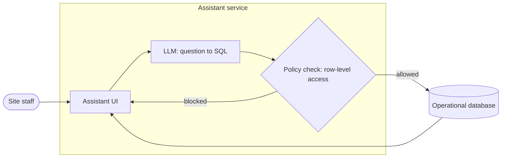
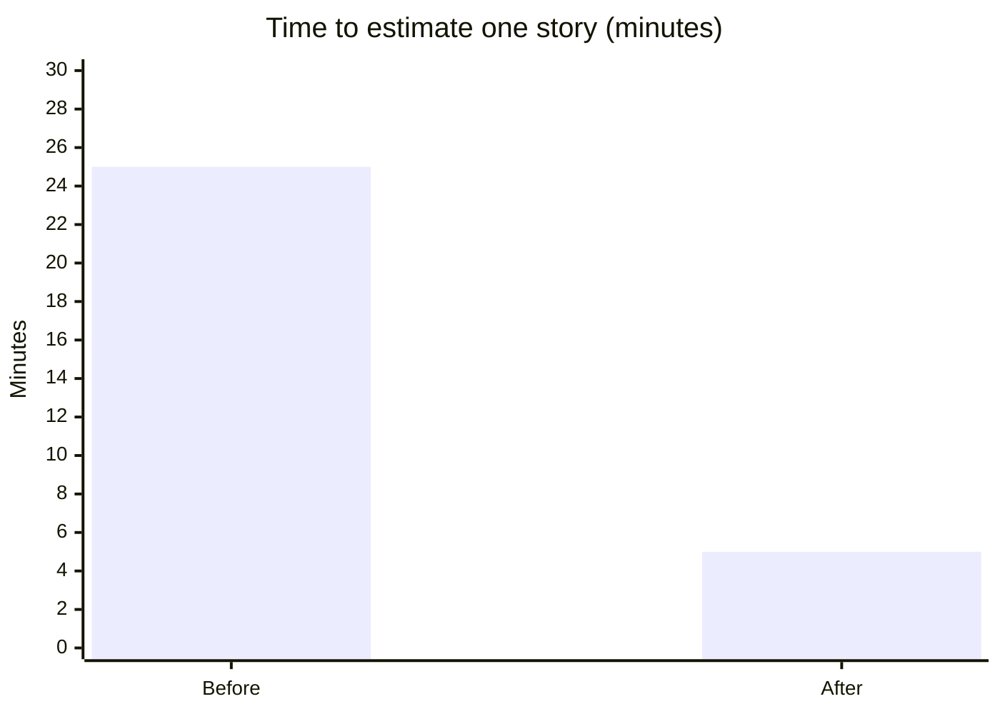
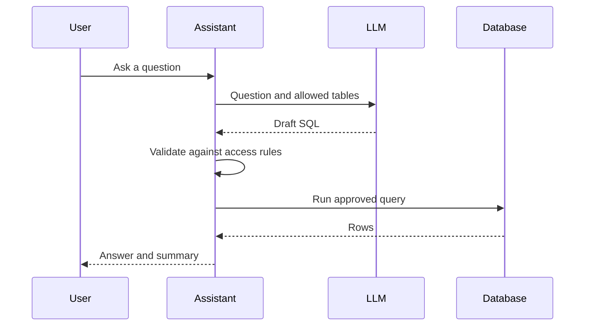

# Instructions: writing a case study for bijonguha.github.io

These instructions are for an AI coding assistant (Claude Code, Kiro, Codex, Cursor or similar)
asked to turn raw project material into a published case study on this site. Read the whole file
before starting. When something here conflicts with a request from Bijon in the chat, follow
Bijon and say what you changed.

---

## 1. What you're producing, and for whom

A case study is a 600–1,200 word story of one piece of client or product work: the situation,
what made it hard, how it was solved, what changed, and what was learned. It lives at
`/case-studies/<file-name>` and may be featured on the homepage.

**Readers**, in order of importance:

1. Hiring managers and CTOs deciding whether to talk to Bijon. They skim: title, summary,
   outcome numbers, diagram.
2. Senior engineers judging depth. They read the approach and the trade-offs.
3. Potential clients asking "has he solved a problem like mine?"

**The goal** is to show judgement and impact, not to document the system. A reader should finish
knowing what the problem was, why it was hard, what Bijon decided and why, and what it achieved.

**The hard constraint**: this is client work. Share knowledge and experience, never the client's
code, data or secrets. Section 3 is not optional.

---

## 2. Inputs you may be given

You'll get some mix of the following. Use all of it for understanding, then publish only
derived, generalised knowledge.

| Input | Use it for | Never publish |
|---|---|---|
| **Codebase** | Architecture, components and how they connect, tech stack, the hard parts (look for retries, caching, guards, queues, evaluation code, TODOs and comments explaining decisions), scale hints in config | Code, file paths, class/function names, prompts, schemas, endpoints, env vars, internal service names |
| **Project data** (CSVs, exports, metrics) | Before/after numbers, volumes, accuracy, latency, cost, adoption | Raw rows, identifiers, anything about a person |
| **Markdown reports** (design docs, retros, READMEs, status reports) | The "why": goals, constraints, alternatives considered, decisions, lessons | Verbatim internal text, names of colleagues, roadmap items |
| **Dashboard screenshots** | Read off numbers and trends | The screenshots themselves (they show client branding, data and names). Recreate the insight as a Mermaid chart instead |
| **Product logs** | Latency distributions, throughput, error rates, usage growth | Log lines, user IDs, hostnames, IPs, request bodies |

If inputs are too large to read fully, sample deliberately: start with READMEs and design docs,
then entry points, then the folders that look like the core of the system, then tests and
evaluation code, which reveal what "good" meant.

---

## 3. Confidentiality rules

Apply every rule to the text, the diagrams, the captions, the alt text, the file names and the
front matter.

1. **Client name.** Use the real name and logo only if Bijon confirms the NDA allows it or the
   client approved. Otherwise describe the client: "a global automotive manufacturer",
   "a healthcare food-service provider operating 500+ facilities". Leave `logo:` empty.
2. **No code.** No snippets, pseudo-code that mirrors real code, prompts, configs, SQL or schemas.
   Explain ideas in words and diagrams.
3. **No internal names.** Replace system, service, team, repo and project code names with plain
   descriptions ("the scheduling service", "the ingestion pipeline").
4. **No people.** No colleague or client staff names, no customer or patient details.
5. **No secrets or infrastructure details.** No URLs, hostnames, account IDs, bucket names,
   model deployment names, keys, or anything that helps someone attack the system.
6. **Numbers.** Round them and prefer relative figures: "~80% faster", "1M+ transactions a day",
   "from minutes to seconds". No contract values, prices, revenue or unreleased plans.
   Every number must trace back to a source you were given (see the facts ledger, section 4).
7. **Images.** Don't publish raw screenshots of client systems. If Bijon supplies an image for the
   post, check it for names, data, URLs and logos; if any appear, say so and suggest blurring or
   cropping (and don't add it yourself).
8. **When unsure, generalise and ask.** Add the question to your final report instead of guessing.

Before finishing, run the red-flag scan in section 9.

---

## 4. Workflow

### Step 1 — Intake (ask before writing)

If not already given, ask Bijon these in one message:

- Which project or engagement, and the working title if he has one.
- Can the client be named? Can their logo be shown?
- His role and the team size; the time frame (for `date:`).
- The single most important outcome he wants the reader to remember.
- Anything that must not be mentioned.
- Which project card on the site it relates to, if any (see section 6, `project:`).

If he's unavailable, proceed with the safe defaults: client described, not named; `draft: true`.

### Step 2 — Build a private facts ledger

Create `.case-study-notes/<file-name>/facts.md` (this folder is git-ignored and never
published). Record every fact you might use, one per line, with its source:

```
- Daily transactions on the database: ~1.2M  [source: logs/2025-06 summary, row "daily_txn"]
- Estimation time per story fell from ~25 min to ~5 min  [source: retro.md, "Results"]
- Chose Text2SQL with row-level security over a vector index because...  [source: design-doc.md §3]
```

Mark anything inferred rather than stated as `[inferred]`. Mark anything you can't support as
`[needs confirmation]`. Only facts with a real source may appear as numbers in the case study.

### Step 3 — Find the story

Before writing, answer these in the notes file, in one or two lines each:

- **The tension:** what made this hard? (Scale, safety, latency, accuracy, messy data, adoption,
  cost, deadline, regulation.) A case study without tension is a feature list.
- **The key decision:** the one or two choices that mattered most, the alternatives, and why.
- **The proof:** the two or three numbers that show it worked.
- **The lesson:** something another team could reuse.
- **The angle for the title:** usually outcome-led ("Cutting story estimation from 25 minutes to 5")
  or problem-led ("Letting 500+ healthcare sites query their data safely with an LLM").

### Step 4 — Write the post

Use the structure and style in sections 5–7. Create the file at
`src/content/case-studies/<file-name>.md` with `draft: true`.

### Step 5 — Diagrams

Add one architecture diagram (always) and, where the data supports it, one results chart.
See section 7.

### Step 6 — Cover and gallery suggestions

See section 8. Suggest; don't invent screenshots.

### Step 7 — Check and preview

1. Run the red-flag scan (section 9).
2. Run `npm run dev` and open `http://localhost:8080/case-studies/<file-name>` (drafts open by their
   own address locally; `http://localhost:8080/case-studies?drafts` lists them). Confirm every
   diagram draws: a broken one shows an amber box with the Mermaid error.
3. Run `npm run build` and confirm it succeeds.

### Step 8 — Report back

End with the report in section 10. Don't set `draft: false`, commit or push unless Bijon asks.

---

## 5. File format (exactly what the site understands)

Front matter goes between `---` lines. Lines starting with `#` are private notes and never show.
Values are plain text; lists use `[a, b, c]`. Don't use a `#` inside a value (it starts a note).

```yaml
---
title: Cutting story estimation from 25 minutes to 5 with an AI copilot
summary: An internal GenAI marketplace whose Jira copilot estimates stories in seconds for 450+ users.
date: 2024-03-01
client: Siemens                # or a description, e.g. Global industrial manufacturer
logo: siemens                  # only if the client may be named; see allowed values below
role: Lead Developer
area: Generative AI
tags: [LLMs, Jira, AWS, FastAPI]
cover: /media/jira-copilot-genai-marketplace/cover.svg
gallery: []                    # e.g. [/media/<file-name>/1.png, /media/<file-name>/flow.gif]
project: Jira Copilot          # optional, exact project name (section 6)
featured: false                # true = may appear on the homepage (top 3)
draft: true                    # Bijon flips this to false to publish
# Confidentiality checklist: see instruction-write-case-studies.md, section 9
---
```

| Field | Rules |
|---|---|
| `title` | 50–80 characters. Specific and outcome- or problem-led. No clickbait, no "How I…" padding. |
| `summary` | One sentence, 110–160 characters. Shown on cards and in link previews. Include the strongest number if allowed. |
| `date` | `YYYY-MM-DD`. Use the project's end date or launch month (day `01` if unknown). |
| `client` | Real name only with permission; otherwise a description. |
| `logo` | Empty, or one of: `bosch`, `cargill`, `compass-digital`, `ford`, `intel`, `neom`, `qpiai`, `siemens`. Never add new brand logos yourself. |
| `role` | Bijon's role, as he states it. |
| `area` | One of: `Generative AI`, `Computer Vision`, `Production ML`, `Mathematical Foundations`, `Developer Tools`. Add a new area only if none fits, and say so in the report. |
| `tags` | 3–6 technologies or techniques a reader would search for. |
| `cover` | Path under `public/`, 16:9. See section 8. |
| `gallery` | Optional list of images, GIFs or videos under `public/`, shown as a clickable grid below the text. |
| `project` | Optional; must exactly match a project name below so the project card links here. |
| `featured` | Only Bijon decides which three are featured. Default `false`. |
| `draft` | Always `true` from you. |

**File name** = URL: lowercase, hyphenated, 3–6 words, no client name unless permitted
(e.g. `llm-text2sql-healthcare-assistant.md`). Must be unique across
`src/content/case-studies/` and `src/content/articles/`.

**Media** go in `public/media/<file-name>/` and are referenced as `/media/<file-name>/...`.

**In the body** you can use: headings (`##`, `###`), paragraphs, lists, tables, `> quotes`,
`**bold**`, links, images ``, GIFs the same way, videos the same way with
an `.mp4`/`.webm` path, and Mermaid diagrams in ```` ```mermaid ```` blocks. There's no HTML
support; don't write raw HTML.

---

## 6. Reference: site facts

- Project names you can use in `project:`: `InterviewValley`, `Content Intelligence`, `MisterMD`,
  `Browsermind`, `Stable Chat`, `Jira Copilot`.
- Existing drafts live in `src/content/case-studies/`. If a draft for the same engagement exists,
  **update that file** instead of creating a new one, and keep its file name.
- Templates: `src/content/case-studies/_TEMPLATE.md` (case studies) and
  `src/content/articles/_TEMPLATE.md` (articles). Files starting with `_` are ignored by the site.
- Facts already public on the site (in `src/config/bijonConfig.ts` and existing drafts) can be
  reused, but still check them against your sources.

---

## 7. Writing the body

### Structure (use these five `##` headings, in this order)

1. **`## Context`** — 2–4 sentences. Industry, scale, users, and why it mattered to the business.
   Set the stakes without jargon.
2. **`## Challenge`** — 1–2 short paragraphs or 3–5 bullets. The specific constraints that made
   this hard. Be concrete ("answers had to respect each site's data access rules", "under 5 seconds
   at 10TB a day"), not generic ("it was complex").
3. **`## Approach`** — the longest section. Open with one paragraph on the overall idea, then the
   architecture diagram, then 2–4 `###` subsections, one per key decision: what was chosen, the
   alternatives, and why. This is where depth shows.
4. **`## Outcome`** — 2–4 bullets, each with a number and what it means for the user or business.
   Optionally a results chart. Then one sentence on what happened next (adoption, rollout, reuse).
5. **`## Lessons`** — 2–4 bullets or a short paragraph. Reusable insight, not self-praise.
   "Guardrails at the data layer were easier to trust than guardrails in the prompt" beats
   "This project taught me a lot."

### Style

- **First person**, active voice: "I designed…", "we chose…" ("we" for team work; be honest about
  Bijon's part).
- **Plain English**, short sentences, one idea per paragraph. Define an acronym the first time.
- **Specific over grand.** Cut: revolutionary, cutting-edge, game-changer, seamless, leverage,
  robust, state-of-the-art, synergy, world-class, unlock, empower, delve.
- **Numbers:** numerals for all figures ("5 teams"), `%` sign, `~` for approximate, `+` for
  "more than" ("450+ users"), units spelled clearly ("10TB a day", "under 200ms").
- **Never invent.** If a number would help but isn't in the ledger, write `[number needed: …]` and
  list it in the report.
- **Captions:** after every diagram or image, add an italic caption line:
  `*Figure 1. How a question becomes a safe, permission-aware query.*`
- **Length:** 600–1,200 words of body text. Shorter is fine if the story is complete.

---

## 8. Diagrams, covers and gallery

### 8.1 Diagrams: Mermaid, drawn by the site

The site draws ```` ```mermaid ```` blocks itself (Mermaid v11) and matches light and dark mode.
Prefer Mermaid over image files: it's text, so it's versioned, reviewable and themeable.

**Which diagram for which job:**

| You want to show | Use |
|---|---|
| System architecture (always include one) | `flowchart LR` with `subgraph`s for layers |
| How one request moves through the system | `sequenceDiagram` (≤ 6 participants) |
| A pipeline or process with stages | `flowchart LR` or `flowchart TB` |
| Before vs after, or a comparison of options | `xychart-beta` bar chart |
| A trend over time (latency, adoption) | `xychart-beta` line chart |
| Phases of the project | `timeline` |
| States of an item (e.g. review workflow) | `stateDiagram-v2` |

**Rules:**

- 6–12 nodes; split into two diagrams rather than one crowded one.
- Labels are generic roles, not internal names: "Ingestion API", "Vector index", "LLM (SQL
  generation)", "Policy check", "Operational DB".
- Put every label in double quotes: `A["LLM: question to SQL"]`. Avoid `#`, `;`, `<`, `>`, `{}`
  and HTML inside labels; avoid parentheses outside quotes.
- Use shapes with meaning: `[( )]` databases, `{ }` decisions, `([ ])` users or external actors.
- Edge labels short: `-->|allowed|`.
- No styling (`style`, `classDef`, colours); the site themes diagrams for light and dark mode.
- Charts must use ledger numbers only; label the axis and units; round values.

**Tested examples (copy and adapt):**

````markdown

*Figure 1. Every generated query passes a data-access check before it runs.*


*Figure 2. Estimation time per story before and after the copilot.*


*Figure 3. One question, end to end.*
````

**Check every diagram** by opening the page in `npm run dev`. If a diagram fails, the page shows
an amber box with the error; fix the syntax and reload. Optionally validate from the terminal:
`npx -y @mermaid-js/mermaid-cli@11 -i diagram.mmd -o /tmp/check.svg`.

**When Mermaid isn't enough** (for example a polished hero diagram), you may hand-write a clean
SVG at `public/media/<file-name>/architecture.svg` (viewBox 1600×900, system font, no embedded
fonts or scripts, generic labels, works on both light and dark backgrounds, e.g. mid-grey strokes on a
transparent background) and embed it with ``.

### 8.2 Cover image (thumbnail) suggestions

Every case study needs a 16:9 cover (1280×720 minimum). It appears on cards and at the top of the
post. The title is printed under the card, so **the cover needs little or no text.**

In your report, suggest **three cover concepts**, each with:

- **Concept:** one line (e.g. "Abstract data streams converging into a shield: safe access at scale").
- **Composition:** focal point, layout, what sits in the centre-safe area (keep key content in the
  middle 70%; cards crop slightly on hover).
- **Palette:** neutral slate background with one accent (blue `#3b82f6`, amber `#f59e0b` or green
  `#10b981`) so covers look like one family.
- **Text overlay:** none, or at most 3–5 words.
- **Image-generator prompt:** ready to paste, e.g. *"Minimal isometric illustration of data streams
  flowing through a glowing shield into a dashboard, slate-grey background, single blue accent,
  soft lighting, no text, no logos, 16:9"*.
- **Avoid:** client logos or branding (unless permitted), real screenshots, faces, stock-photo clichés
  (robots shaking hands, glowing brains).

If Bijon asks you to make the cover, generate an abstract SVG yourself at
`public/media/<file-name>/cover.svg` (1280×720 viewBox, geometric shapes from the diagram's
structure, palette above, no text or client marks) and set `cover:` to it.

### 8.3 Gallery

`gallery:` holds extra visuals shown as a clickable grid under the post. Suggest what would help
(a redacted UI screenshot, a short GIF of the flow, a results chart exported as PNG), but only add
files Bijon provides or you created from scratch. For GIFs, prefer short MP4s; to make one from a
screen recording:

```bash
ffmpeg -i recording.mov -vf "scale=1280:-2,fps=24" -an -c:v libx264 -crf 28 -pix_fmt yuv420p clip.mp4
ffmpeg -i clip.mp4 -frames:v 1 poster.jpg     # still frame for a cover or poster
```

---

## 9. Red-flag scan (run before finishing)

Search the post, captions, front matter and any files you created. Fix every hit or list it in
the report.

- [ ] Client or brand names other than in `client:`/`logo:` (and those only with permission)
- [ ] People's names, emails, user IDs, patient or customer details
- [ ] Code, SQL, prompts, configs, schemas, file paths, function or class names
- [ ] Internal system, repo, team or project code names
- [ ] URLs, hostnames, IPs, cloud account or bucket names, keys
- [ ] Money: prices, contract values, revenue
- [ ] Any number not in the facts ledger, or more precise than needed
- [ ] Screenshots of client systems
- [ ] Diagrams with internal names or more than ~12 nodes
- [ ] Banned hype words (section 7)
- [ ] All five `##` sections present; every diagram and image has a caption
- [ ] `draft: true`; file name and media folder match; `npm run build` passes

---

## 10. Final report to Bijon

End your turn with this, in the chat (not in the post):

```
Case study drafted: src/content/case-studies/<file-name>.md  (draft, preview at /case-studies/<file-name>)

Story angle: <one line>
Headline numbers used: <list, each with its source>
Diagrams: <list with figure captions>

Needs your input:
- <client naming / logo permission>
- <each [number needed] or [needs confirmation] item>
- <anything you generalised and why>

Cover concepts:
1. <concept> — prompt: "<image prompt>"
2. ...
3. ...

Gallery suggestions: <what visuals would help, and what must be redacted>
Red-flag scan: <clean / items found and fixed / items left for you>
To publish: set draft: false (and featured: true if it should be on the homepage).
```

---

## 11. A short example of the finished shape

```markdown
---
title: Letting 500+ healthcare sites query their data safely with an LLM
summary: A Text2SQL assistant over a database handling 1M+ transactions a day, with access rules enforced on every query.
date: 2025-06-01
client: Healthcare food-service provider
role: Lead Developer
area: Generative AI
tags: [LLMs, Text2SQL, Row-level security, Guardrails]
cover: /media/llm-text2sql-healthcare-assistant/cover.svg
draft: true
---

## Context

Site managers across 500+ healthcare facilities needed answers from operational data ...

## Challenge

- Every answer had to respect which sites and records a user may see.
- ...

## Approach

The core idea was to let the model write the query, but never let it decide what data it could reach. ...

(mermaid architecture diagram + caption)

### Enforcing access below the model
...

## Outcome

- Live across 500+ facilities ...

## Lessons

- Guardrails at the data layer were easier to test and trust than guardrails in the prompt.
```
