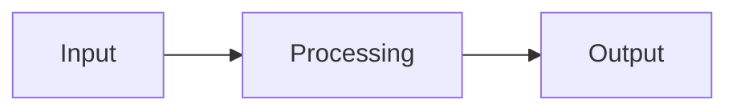

Copy this file into src/content/articles/, rename it (the file name becomes the URL:
/writing/<file-name>) and write in Markdown. Put images, GIFs and videos in
public/media/articles/<your-article>/.

## A heading

Normal paragraphs, **bold**, *italic*, [links](https://example.com), `inline code`.

- Bullet lists
- and numbered lists

| Tables | work |
| ------ | ---- |
| too    | yes  |

```python
print("Code blocks are highlighted as plain code")
```

An image:


A GIF (works exactly like an image):


A video (an image link that ends in .mp4 or .webm becomes a player):


> Quotes and call-outs use a leading ">".

A diagram (drawn by the site, follows light/dark mode):


*Figure 1. One-line caption.*
