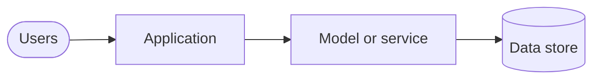

Copy this file, rename it (the file name becomes the URL: /case-studies/<file-name>) and
write in Markdown. Share how you think and what you learned, not the client's secrets.

## Context

The industry, the scale and who the users were.

## Challenge

What made it hard: data, scale, latency, safety, accuracy or adoption.

## Approach

The key decisions and the trade-offs you weighed, at box-and-arrow level.

*Figure 1. One-line caption explaining the diagram.*

See instruction-write-case-studies.md, section 8, for diagram types and rules.

## Outcome

- Two or three measured results, rounded if needed.

## Lessons

What you'd tell another team taking on something similar.
